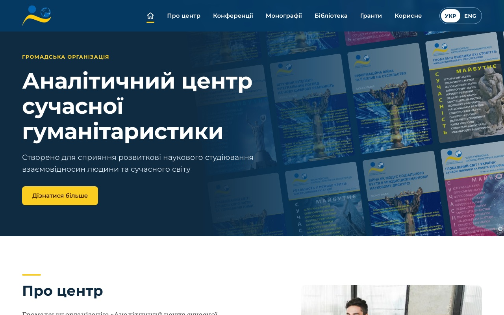
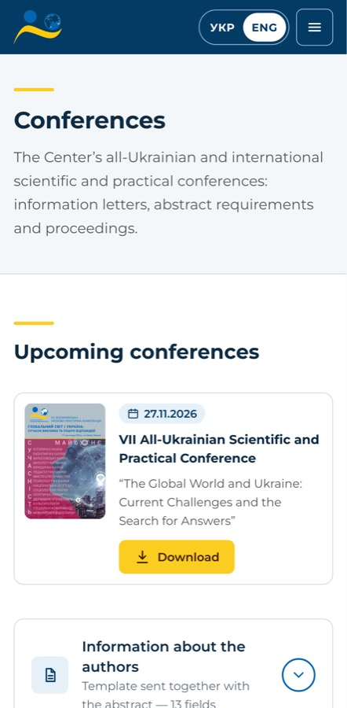

# Analytical Center of Modern Humanitarian Studies

Website of «Аналітичний центр сучасної гуманітаристики», a Ukrainian
non-governmental research organization in the humanities: conferences,
collective monographs, a free library, grants and the people behind them.

**Live:** [acmhs.in.ua](https://acmhs.in.ua) (Ukrainian) ·
[acmhs.in.ua/en](https://acmhs.in.ua/en) (English)

<p>
  
  
</p>

## Stack

| Layer   | Choice                                                                                                    |
| ------- | --------------------------------------------------------------------------------------------------------- |
| App     | Next.js 16 (App Router, Turbopack), React 19, TypeScript strict                                           |
| Styling | Tailwind CSS 4: design tokens in `@theme`, no config file                                                 |
| Content | Sanity (Studio at `/studio`, GROQ + TypeGen), images resized on Sanity's CDN                              |
| i18n    | next-intl: Ukrainian at `/`, English at `/en`, hreflang, per-locale metadata and OG images                |
| SEO/AI  | Sitemap, robots, JSON-LD (Organization, Event, Book, Person), [`/llms.txt`](https://acmhs.in.ua/llms.txt) |
| Hosting | Vercel                                                                                                    |
| Tests   | Vitest + Testing Library, Playwright (desktop + mobile), visual diff at 375 / 768 / 1280 px               |

## How it fits together

```
Editor ── Sanity Studio (/studio) ── publish ──► Sanity Content Lake
                                                   │        │
                              webhook (signed)  ◄──┘        │ GROQ, $locale
                                   │                        ▼
                      /api/revalidate ── revalidateTag(_type) ──► cached fetches
                                                                    │
Visitor ──► proxy.ts (locale) ──► app/[locale]/(site)/* server components
                                    ├─ UI labels: messages/{uk,en}.json
                                    └─ content: src/lib/sanity/content.ts
```

- **Content** lives in Sanity. Every text field is `{ uk, en }`. Queries read
  the request's language and fall back to Ukrainian, marking the fallback with
  `lang="uk"` so screen readers and search engines know.
- **Caching:** every query is cached and tagged with its document type. A
  publish in Studio calls the webhook, which revalidates just that type: no
  redeploys for content.
- **Upcoming vs archive** is derived from the date and which file is attached,
  not a status field.
- **Accessibility:** contrast checked against WCAG 2.2 AA in the design system;
  keyboard paths and focus management are covered by e2e tests; Lighthouse
  accessibility is 100 on every measured page.

## Results

Lighthouse, mobile, on the live site:

| Page           | Before (2026-10-17)            | After (latest live)             |
| -------------- | ------------------------------ | ------------------------------- |
| `/`            | Perf 96 · A11y 96 · SEO 100    | Perf 97 · A11y 100 · SEO 100    |
| `/conferences` | Perf 74 · A11y 100 · CLS 0.408 | Perf 98–99 · A11y 100 · CLS 0   |
| `/en`          | (no English)                   | Perf 88–96 · A11y 100 · SEO 100 |

The full log and the phase-by-phase plan are in
[docs/modernization.md](docs/modernization.md).

## Run it

```bash
cp .env.example .env.local   # the public Sanity project is filled in
npm install
npm run dev                  # http://localhost:3000, Studio at /studio
```

| Script                | What it does                                        |
| --------------------- | --------------------------------------------------- |
| `npm run test-all`    | Format, lint, types, unit tests, build, e2e (as CI) |
| `npm test`            | Unit tests                                          |
| `npm run test:e2e`    | Playwright against `next start` (build first)       |
| `npm run typegen`     | Sanity schema + GROQ → `src/lib/sanity/types.ts`    |
| `npm run screenshots` | Every route at 3 widths, for visual diffs           |

## Working with Claude Code

The repo is set up for AI-assisted work: `CLAUDE.md` for the essentials,
path-scoped rules in `.claude/rules/`, and skills for repeatable jobs
(`visual-check`, `add-publication`, `translate`, `release-check`). Content edits
go through the Sanity MCP server.

## License

Code: [MIT](LICENSE). The content, logos, publications and photos belong to the
Analytical Center of Modern Humanitarian Studies and are not covered by the
license.
